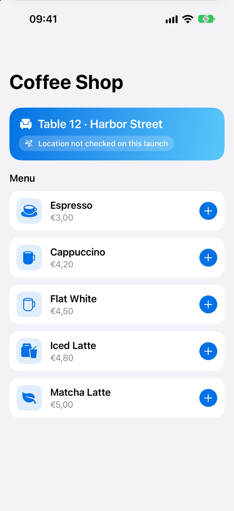
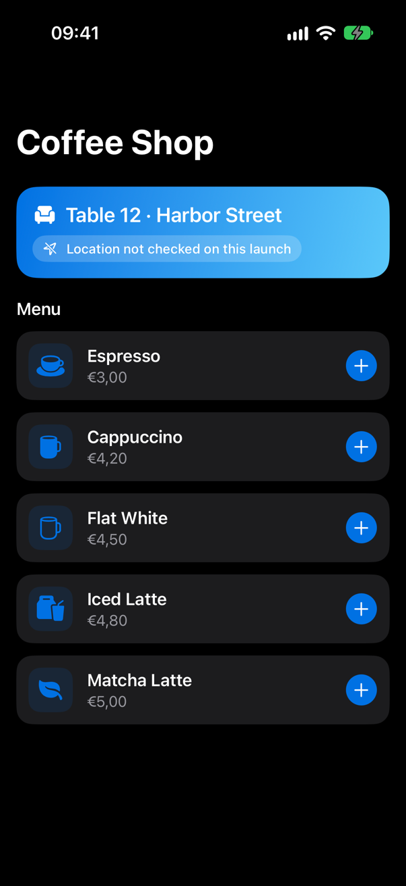
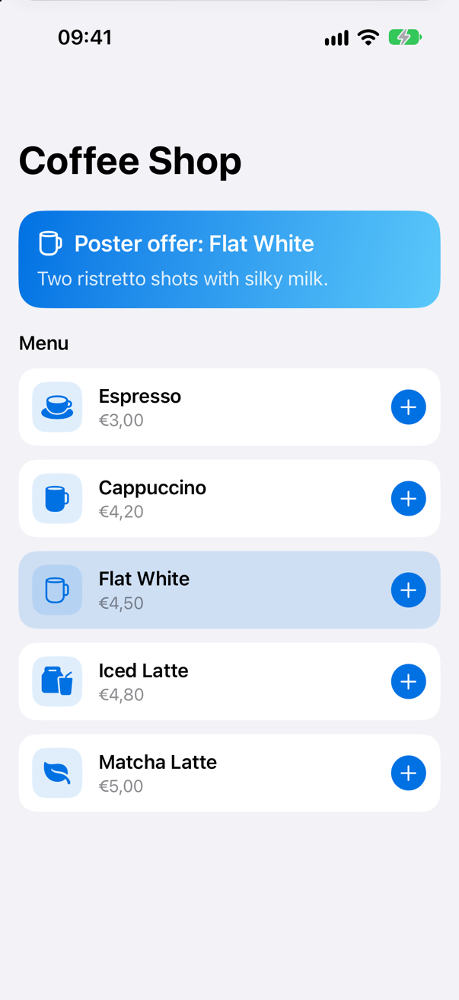
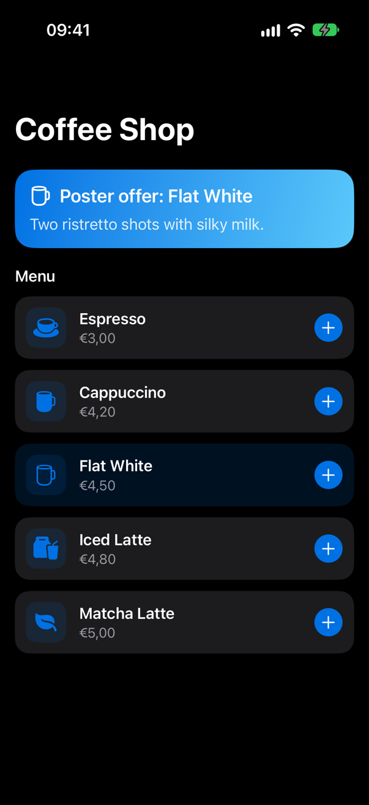

<!-- i18n-source: README.md@3cf58e24b820b24a8295e661fa1b11e872eb9e84 status=reviewed -->
<!-- brand:start -->

<p align="center"><picture><source media="(prefers-color-scheme: dark)" srcset="https://raw.githubusercontent.com/muhittincamdali/AppClipsStudio/master/.github/brand/banner-pt-BR-dark.svg"><source media="(prefers-color-scheme: light)" srcset="https://raw.githubusercontent.com/muhittincamdali/AppClipsStudio/master/.github/brand/banner-pt-BR-light.svg"></picture></p>

<!-- lang-selector:start -->
<p align="center"><a href="README.md">English</a> · <a href="README.tr.md">Türkçe</a> · <a href="README.zh-CN.md">简体中文</a> · <a href="README.ja.md">日本語</a> · <a href="README.ko.md">한국어</a> · <a href="README.es.md">Español</a> · <a href="README.de.md">Deutsch</a> · <a href="README.fr.md">Français</a> · <a href="README.pt-BR.md">Português (Brasil)</a> · <a href="README.ru.md">Русский</a></p>
<!-- lang-selector:end -->

<p align="center">
<a href="https://github.com/muhittincamdali/AppClipsStudio/actions/workflows/ci.yml"></a>
<a href="https://github.com/muhittincamdali/AppClipsStudio/releases"><picture><source media="(prefers-color-scheme: dark)" srcset="https://raw.githubusercontent.com/muhittincamdali/AppClipsStudio/master/.github/brand/badge-version-dark.svg"><source media="(prefers-color-scheme: light)" srcset="https://raw.githubusercontent.com/muhittincamdali/AppClipsStudio/master/.github/brand/badge-version-light.svg"></picture></a>
<a href="https://github.com/muhittincamdali/AppClipsStudio/blob/master/Package.swift"><picture><source media="(prefers-color-scheme: dark)" srcset="https://raw.githubusercontent.com/muhittincamdali/AppClipsStudio/master/.github/brand/badge-platforms-dark.svg"><source media="(prefers-color-scheme: light)" srcset="https://raw.githubusercontent.com/muhittincamdali/AppClipsStudio/master/.github/brand/badge-platforms-light.svg"></picture></a>
<a href="https://github.com/muhittincamdali/AppClipsStudio/blob/master/Package.swift"><picture><source media="(prefers-color-scheme: dark)" srcset="https://raw.githubusercontent.com/muhittincamdali/AppClipsStudio/master/.github/brand/badge-language-dark.svg"><source media="(prefers-color-scheme: light)" srcset="https://raw.githubusercontent.com/muhittincamdali/AppClipsStudio/master/.github/brand/badge-language-light.svg"></picture></a>
<a href="https://github.com/muhittincamdali/AppClipsStudio/blob/master/LICENSE"><picture><source media="(prefers-color-scheme: dark)" srcset="https://raw.githubusercontent.com/muhittincamdali/AppClipsStudio/master/.github/brand/badge-license-dark.svg"><source media="(prefers-color-scheme: light)" srcset="https://raw.githubusercontent.com/muhittincamdali/AppClipsStudio/master/.github/brand/badge-license-light.svg"></picture></a>
</p>

<p align="center">
<a href="#início-rápido"><picture><source media="(prefers-color-scheme: dark)" srcset="https://raw.githubusercontent.com/muhittincamdali/AppClipsStudio/master/.github/brand/button-start-pt-BR-dark.svg"><source media="(prefers-color-scheme: light)" srcset="https://raw.githubusercontent.com/muhittincamdali/AppClipsStudio/master/.github/brand/button-start-pt-BR-light.svg"></picture></a>
<a href="https://muhittincamdali.github.io/AppClipsStudio/documentation/appclipsstudio/"><picture><source media="(prefers-color-scheme: dark)" srcset="https://raw.githubusercontent.com/muhittincamdali/AppClipsStudio/master/.github/brand/button-docs-pt-BR-dark.svg"><source media="(prefers-color-scheme: light)" srcset="https://raw.githubusercontent.com/muhittincamdali/AppClipsStudio/master/.github/brand/button-docs-pt-BR-light.svg"></picture></a>
<a href="https://github.com/muhittincamdali/AppClipsStudio/tree/master/Examples"><picture><source media="(prefers-color-scheme: dark)" srcset="https://raw.githubusercontent.com/muhittincamdali/AppClipsStudio/master/.github/brand/button-examples-pt-BR-dark.svg"><source media="(prefers-color-scheme: light)" srcset="https://raw.githubusercontent.com/muhittincamdali/AppClipsStudio/master/.github/brand/button-examples-pt-BR-light.svg"></picture></a>
</p>

> Esta é uma tradução do README em inglês. Se houver diferença, vale a versão em inglês.

<!-- brand:end -->

Um pacote Swift para App Clips do iOS e para os apps a que eles pertencem. Ele valida a URL de
invocação que o sistema passa na abertura e a roteia para as suas telas da mesma forma que o App
Store Connect a roteia para as experiências do App Clip, confirma que a pessoa está onde o código
está e entrega os dados do App Clip ao app completo. A ferramenta de linha de comando
`appclipstudio` verifica, antes do envio, o que o App Store Connect e o sistema vão verificar: o
tamanho de cada variante, as URLs dos App Clip Codes, o arquivo `apple-app-site-association` e as
entradas de Associated Domains. O pacote não tem dependências.

## Destaques

- **Roteamento de invocações com a regra de correspondência da Apple** — padrões como
  `/table/:number` e `/shop/*`; vence o prefixo mais específico, como no App Store Connect, e um
  fallback cobre o restante de um prefixo registrado, que a Apple exige que o App Clip e o app
  completo tratem. Os links padrão de App Clip (`https://appclip.apple.com/id?p=…`) são
  reconhecidos.
- **Entrada não confiável permanece limitada** — as URLs de invocação são verificadas (esquema,
  host, comprimento, tamanho do caminho e da query, componentes `.`/`..`) antes de chegarem ao seu
  código; os números são interpretados sem causar falhas; os relatórios de tamanho rejeitam `nan`,
  `inf` e `1e999`; os arquivos são lidos com um limite; a varredura de pastas não segue links
  simbólicos; a saída nunca reproduz caracteres de controle.
- **Verificação de tamanho por variante** — os limites da Apple de 10, 15 e 100 MB são aplicados a
  cada variante do `App Thinning Size Report.txt` do Xcode, por versão do iOS, alvo de implantação e
  tipo de invocação, com um código de saída para o CI.
- **Associação com o site** — gere e valide o `apple-app-site-association`, verifique as entradas
  de entitlements `appclips:`/`applinks:` e analise as URLs de App Clip Codes de acordo com as
  regras de codificação da Apple.
- **O momento depois da tarefa** — confirmação de localização com uma região validada de 500 m, o
  overlay da App Store para o app completo e o `HandoffStore`, que passa ao app completo um valor
  versionado, com prazo de validade e tamanho limitado, por meio do App Group compartilhado.
- **Testado** — 114 testes de Swift Testing rodam no macOS e em um simulador de iPhone, incluindo
  os casos extremos acima e o início rápido abaixo.
- **Um exemplo que compila** — o [Examples/CoffeeShop](Examples/CoffeeShop) é um app e o seu App
  Clip a partir das mesmas fontes; o CI o compila e os exemplos de Uso são copiados dele.

## Início rápido

**1. Adicione o pacote**

No Xcode, escolha **File › Add Package Dependencies…** e informe a URL do repositório:

```text
https://github.com/muhittincamdali/AppClipsStudio.git
```

Deixe **Dependency Rule** em **Up to Next Major Version** a partir de `2.0.0` e clique em **Add
Package**. Na janela seguinte, escolha o alvo do seu App Clip ao lado de **AppClipsStudio** e clique
em **Add Package** outra vez. (Se o seu projeto ainda não tem um App Clip, adicione um com **File ›
New › Target… › App Clip**; adicione o pacote também ao alvo do app completo.)

**2. Roteie a invocação**

Substitua todo o conteúdo do `ContentView.swift` do App Clip por:

```swift
import AppClipsStudio
import SwiftUI

enum Screen: Equatable {
    case welcome
    case table(Int)
}

struct ContentView: View {
    @State private var screen = Screen.welcome

    var body: some View {
        Group {
            switch screen {
            case .welcome: Text("Scan a table tag")
            case .table(let number): Text("Table \(number)")
            }
        }
        .font(.largeTitle)
        .onInvocation { invocation in
            screen = (try? Self.router.route(invocation)) ?? .welcome
        }
    }

    static let router: InvocationRouter<Screen> = {
        var router = InvocationRouter<Screen>()
        try? router.add("/table/:number") { match in
            match.integer("number").map(Screen.table)
        }
        router.fallback { _ in .welcome }
        return router
    }()
}
```

**3. Execute com uma URL de invocação**

Escolha **Product › Scheme › Edit Scheme…**, selecione **Run › Arguments** e defina a variável de
ambiente `_XCAppClipURL` (o Xcode a adiciona a todo scheme de App Clip) como
`https://appclip.example.com/table/12`. Escolha um simulador de iPhone e pressione **Run** (⌘R). O
App Clip mostra "Table 12"; com `/table/twelve` ou sem caminho, mostra "Scan a table tag".

O mesmo código é compilado e testado em
[`Tests/AppClipsStudioTests/ReadmeQuickStartTests.swift`](Tests/AppClipsStudioTests/ReadmeQuickStartTests.swift).

## Instalação

### Swift Package Manager

Adicione a biblioteca aos alvos do App Clip e do app completo no Xcode, como no início rápido, ou
no `Package.swift`:

```swift
dependencies: [
    .package(url: "https://github.com/muhittincamdali/AppClipsStudio.git", from: "2.0.0")
],
targets: [
    .target(name: "YourAppFeature", dependencies: [
        .product(name: "AppClipsStudio", package: "AppClipsStudio")
    ])
]
```

### Ferramenta de linha de comando

```sh
git clone https://github.com/muhittincamdali/AppClipsStudio.git
cd AppClipsStudio
swift build -c release
cp .build/release/appclipstudio /usr/local/bin/   # or run it with `swift run appclipstudio`
```

A versão 2.0.0 (outubro de 2026) é a primeira publicação deste código. A anterior, a 1.0.0
(fevereiro de 2026), descrevia módulos que nunca foram implementados; em junho de 2026 eles foram
reduzidos a stubs, e em outubro de 2026 o pacote foi reescrito a partir da documentação da Apple
sobre App Clips. O [CHANGELOG.md](CHANGELOG.md) lista o que mudou.

## Uso

Os exemplos abaixo foram copiados do app de exemplo
[`Examples/CoffeeShop`](Examples/CoffeeShop), que o CI compila.

### Rotas

De [`Shared/CoffeeRoutes.swift`](Examples/CoffeeShop/Shared/CoffeeRoutes.swift): uma tag de mesa, um
código de pôster e o link padrão do App Clip, com o menu para qualquer outra URL.

```swift
var router = InvocationRouter<CoffeeScreen>(
    allowedHosts: ["appclip.example.com", "example.com", Invocation.defaultLinkHost]
)
try router.add("/table/:number") { match in
    guard let number = match.integer("number"), (1...99).contains(number),
          let store = match.queryInteger("p").flatMap(Catalog.store(id:)) else { return nil }
    return .table(store, number: number)
}
try router.add("/order") { match in
    match.queryInteger("p").flatMap(Catalog.drink(id:)).map(CoffeeScreen.drink)
}
try router.add("appclip.apple.com/id") { match in
    match.queryInteger("drink").flatMap(Catalog.drink(id:)).map(CoffeeScreen.drink)
}
router.fallback { _ in .menu }
```

Um handler que retorna `nil` (uma loja desconhecida, um número de mesa fora do intervalo) deixa a
próxima rota tentar e, por fim, o fallback.

### Aberturas sem URL

De [`Shared/CoffeeModel.swift`](Examples/CoffeeShop/Shared/CoffeeModel.swift). Quem volta de uma
notificação ou do seletor de apps abre o App Clip sem URL, então cada invocação é salva e
restaurada:

```swift
func handle(_ invocation: Invocation) {
    do {
        screen = try router.route(invocation) ?? .menu
        lastInvocation.save(invocation)
        rejection = nil
    } catch {
        rejection = error
    }
}
```

### Confirmação de localização e overlay da App Store

De [`Shared/RootView.swift`](Examples/CoffeeShop/Shared/RootView.swift), somente no App Clip (a
condição de compilação `APPCLIP`):

```swift
.onContinueUserActivity(NSUserActivityTypeBrowsingWeb) { activity in
    guard let invocation = try? Invocation(userActivity: activity) else { return }
    model.handle(invocation)
    if let payload = activity.appClipActivationPayload {
        Task { await model.confirmLocation(with: payload) }
    }
}
.fullAppOverlay(isPresented: $model.showsFullAppOverlay)
```

```swift
func confirmLocation(with payload: APActivationPayload) async {
    guard case .table(let store, _) = screen else { return }
    confirmation = await payload.confirm(store.location)
}
```

A `location` de cada loja é uma `ExpectedLocation`, que só aceita coordenadas finitas dentro do
intervalo e um raio maior que 0 e de no máximo 500 metros, o limite da Apple.

### Entregando o pedido ao app completo

```swift
func placeOrder() {
    var order = PlacedOrder(drinkIDs: cart.map(\.id), placedAt: Date())
    if case .table(let store, let number) = screen {
        order.storeID = store.id
        order.table = number
    }
    try? handoff?.save(order, expiresAfter: 30 * 24 * 60 * 60)
    placedOrder = order
    cart = []
    #if APPCLIP
    showsFullAppOverlay = true
    #endif
}

/// In the full app: takes the order the App Clip left, once.
func importHandoff() {
    importedOrder = try? handoff?.take()
}
```

`handoff` é um `HandoffStore<PlacedOrder>` sobre a suíte de `UserDefaults` do App Group,
compartilhada pelos dois alvos.

## Ferramenta de linha de comando

Verifique todas as variantes de um App Clip exportado (o código de saída é 1 quando alguma passa do
limite):

```text
$ appclipstudio size "App Thinning Size Report.txt" --deployment-target 16.0
App Clip size check (iOS 16+, physical and digital invocations)
  ok   ExampleClip-a.ipa  14.60 MB of 15.00 MB
  OVER ExampleClip-b.ipa  15.20 MB of 15.00 MB
1 of 2 variants are over the limit.
```

Verifique as URLs dos App Clip Codes:

```text
$ appclipstudio check-url https://www.example.com/products/
https://www.example.com/products/
  suggestion: Remove the "www" subdomain if your site allows it.
  suggestion: Remove the trailing "/".
```

Gere e valide o arquivo de associação e verifique as entradas de entitlements:

```sh
appclipstudio aasa generate --app ABCDE12345.com.example.MyApp \
  --app-clip ABCDE12345.com.example.MyApp.Clip --path "/table/*" > apple-app-site-association
appclipstudio aasa validate apple-app-site-association --app-clip ABCDE12345.com.example.MyApp.Clip
appclipstudio check-domain appclips:appclip.example.com applinks:example.com
```

Todos os comandos aceitam `--json`. `appclipstudio help` lista as opções.

## Demonstração

O App Clip de exemplo aberto com a URL de uma tag de mesa e a URL de um pôster:

| Tag de mesa (claro)                                                  | Tag de mesa (escuro)                                                 | Pôster (claro)                                                           | Pôster (escuro)                                                          |
| -------------------------------------------------------------------- | -------------------------------------------------------------------- | ------------------------------------------------------------------------ | ------------------------------------------------------------------------ |
|  |  |  |  |

As capturas de tela são feitas em um simulador de iPhone pelo
[`scripts/capture-screenshots.sh`](scripts/capture-screenshots.sh). No simulador, o sistema não
passa nenhum payload de ativação, por isso o selo mostra "Location not checked on this launch".

Para experimentar por conta própria, abra o `CoffeeShop.xcodeproj` em
[`Examples/CoffeeShop`](Examples/CoffeeShop), escolha o scheme **CoffeeShopClip** e um simulador de
iPhone e pressione **Run**. O [Examples/README.md](Examples/README.md) tem os detalhes.

## Documentação

- [Referência da API](https://muhittincamdali.github.io/AppClipsStudio/documentation/appclipsstudio/)
  (DocC, publicada no GitHub Pages a partir da `master`)
- Compile-a localmente no Xcode com **Product › Build Documentation**, ou pela linha de comando:

```sh
xcodebuild docbuild -scheme AppClipsStudio -destination 'generic/platform=iOS Simulator'
```

## Guias

- [Getting Started](https://muhittincamdali.github.io/AppClipsStudio/documentation/appclipsstudio/gettingstarted)
  — adicione o pacote aos dois alvos, roteie a invocação e teste
  ([fonte](Sources/AppClipsStudio/AppClipsStudio.docc/GettingStarted.md)).
- [Routing Invocations](https://muhittincamdali.github.io/AppClipsStudio/documentation/appclipsstudio/routinginvocations)
  — o que é verificado, a sintaxe dos padrões e qual rota vence
  ([fonte](Sources/AppClipsStudio/AppClipsStudio.docc/RoutingInvocations.md)).
- [Checking App Clip Size](https://muhittincamdali.github.io/AppClipsStudio/documentation/appclipsstudio/checkingappclipsize)
  — os limites da Apple, o relatório de tamanho e o comando `size`
  ([fonte](Sources/AppClipsStudio/AppClipsStudio.docc/CheckingAppClipSize.md)).
- [Associating Your Website](https://muhittincamdali.github.io/AppClipsStudio/documentation/appclipsstudio/associatingyourwebsite)
  — entradas de entitlements, `apple-app-site-association` e URLs de App Clip Codes
  ([fonte](Sources/AppClipsStudio/AppClipsStudio.docc/AssociatingYourWebsite.md)).
- [Handing Off to the Full App](https://muhittincamdali.github.io/AppClipsStudio/documentation/appclipsstudio/handingofftothefullapp)
  — confirmação de localização, overlay da App Store, notificações e `HandoffStore`
  ([fonte](Sources/AppClipsStudio/AppClipsStudio.docc/HandingOffToTheFullApp.md)).

## Requisitos

| Plataforma  | Versão mínima                                                                       |
| ----------- | ----------------------------------------------------------------------------------- |
| iOS         | 16 (a confirmação de localização e o overlay existem apenas no iOS)                 |
| macOS       | 13 (a ferramenta de linha de comando e as verificações independentes de plataforma) |
| Ferramentas | Swift 6.2 · Xcode 26+                                                               |

O CI compila com o Xcode padrão da imagem de runner `macos-26` do GitHub. O pacote é desenvolvido
com o Xcode 27. O app de exemplo tem como alvo o iOS 17.

## Arquitetura

- `Sources/AppClipsStudio` é a biblioteca, com uma pasta por tarefa: `Invocation`, `Routing`,
  `Size`, `AppClipCode`, `Association`, `Handoff`, `Location` e `Promotion`. Tudo, exceto os
  modifiers do SwiftUI e a extensão de `APActivationPayload`, são tipos de valor e funções puras,
  então também roda e é testado no macOS.
- Os erros são tipados (`throws(InvocationError)`, `throws(ThinningReportError)`, …), para que
  quem chama possa usar `switch` em todos os casos.
- `Sources/AppClipsStudioTool` reúne os comandos da ferramenta de linha de comando como biblioteca,
  para que os testes os chamem diretamente; `Sources/appclipstudio` apenas repassa os argumentos.
- O CI executa `swift test` no macOS e `xcodebuild test` em um simulador de iPhone, compila o app
  de exemplo e publica a documentação DocC.

Execute os testes localmente:

```sh
swift test                                    # macOS
xcodebuild test -scheme AppClipsStudio-Package \
  -destination 'platform=iOS Simulator,name=iPhone 17'
```

## Roteiro

- Adicionar o pacote ao Swift Package Index; o `.spi.yml` já está no repositório.
- Ler os tamanhos direto de um `.ipa` exportado, sem o relatório de tamanho.
- Uma lista de experiências de App Clip para a API do App Store Connect (experiências avançadas por local).

## Como contribuir

Contribuições são bem-vindas. Leia o [guia de contribuição](https://github.com/muhittincamdali/AppClipsStudio/blob/master/CONTRIBUTING.md) e o [código de conduta](https://github.com/muhittincamdali/.github/blob/main/CODE_OF_CONDUCT.md) antes de abrir um pull request. Relate problemas de segurança de forma privada, como descrito na [política de segurança](https://github.com/muhittincamdali/.github/blob/main/SECURITY.md).

## Licença

Publicado sob a licença MIT. Veja [LICENSE](LICENSE).
